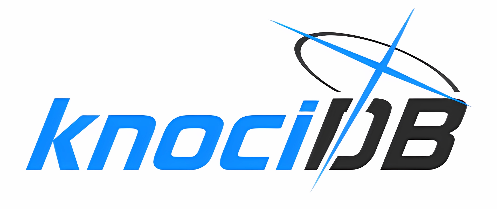

# knociDB
[](https://github.com/knoci/knociDB/releases)
[](https://github.com/knoci/knociDB/main/LICENSE)
[](https://codecov.io/gh/knoci/knociDB)
[](https://github.com/knoci/knociDB/actions/workflows/golangci-lint.yml)
[](https://github.com/knoci/knociDB/actions/workflows/go.yml)
[](https://github.com/knoci/knociDB/issues)


### English | [中文](README_CN.md) | [日本語](README_JP.md)

## Features
- ⚡ **Ultra-fast embedded engine**: custom MVCC Arena Skiplist (`arenaskl`), pipelined WAL Group Commit + 32 KB block cache, zero-freeze snapshot iterators, and O(log N) prefix seeks
- 🔄 **Atomic batches & embedded TTL**: cross-shard ACD batch commits and zero-sidecar embedded `ExpireAt` metadata without `TTL.DB` write amplification
- 🌲 **B+Tree index & online CAS compaction**: single-transaction sorted flushes (`ApplyBatch`) and lock-free `CompareAndSwapBatch` compaction concurrent with writes and flushes
- 🌐 **Production Multi-Raft (`ClusterDB`)**: Dragonboat `IOnDiskStateMachine`, non-blocking streaming `KRS2` snapshots, compact binary Raft codec, mTLS, configurable `ReadConsistency`, `BatchID` idempotency, and Raft-deterministic TTL
- 💾 **Object tier & atomic manifest**: cold VLOG segment offloading and snapshots on S3/R2/COS/OSS with durable atomic manifest tracking
- 🔌 **gRPC v2 & observability**: `PutWithTTL`/`GetTTL`/`Persist`, paginated `ScanLimit`, `grpc.health.v1`, Server Reflection, `DB.Stats()`, `/metrics` (Prometheus), `/healthz`, `/readyz`, `/debug/pprof/`, unified `cmd/knocidb`, and `Dockerfile`

## Quick Start
```go
package main

import (
	"fmt"
	"time"

	"github.com/knoci/knocidb"
)

// this file shows how to use the basic operations of knociDB
func main() {
	options := knocidb.NewDefaultOptions("/tmp/knocidb_basic")

	// open database
	db, err := knocidb.Open(options)
	if err != nil {
		panic(err)
	}
	defer func() {
		_ = db.Close()
	}()

	// put a key
	if err := db.Put([]byte("name"), []byte("knocidb")); err != nil {
		panic(err)
	}

	// get a key
	val, err := db.Get([]byte("name"))
	if err != nil {
		panic(err)
	}
	fmt.Println(string(val))

	// put a key with embedded-metadata TTL
	if err := db.PutWithTTL([]byte("session"), []byte("alive"), 30*time.Second); err != nil {
		panic(err)
	}

	// read remaining TTL
	if ttl, ok, err := db.GetTTL([]byte("session")); err != nil {
		panic(err)
	} else if ok {
		fmt.Println(ttl.String())
	}

	// inspect live engine metrics
	stats := db.Stats()
	fmt.Printf("shards=%d seq=%d\n", stats.Shards, stats.Sequence)

	// delete a key
	if err := db.Delete([]byte("name")); err != nil {
		panic(err)
	}
}
```

## Examples
🚀 For headless standalone gRPC or Multi-Raft cluster server deployments (with Prometheus `/metrics`, `/healthz`, `/readyz`, `/debug/pprof/`), use `cmd/knocidb` or the included `Dockerfile`:
```bash
$ go run ./cmd/knocidb --mode=standalone --data-dir=./data --grpc-addr=:9090 --admin-addr=:9091
```

💡 For Cluster usage, please check out usage examples in the `examples/cluster` directory, and you can get the specific method of using Cluster through the README document.
```bash
$ cd examples/cluster
$ go build -o cluster-example main.go
```

Set `config.ShardCount` before `OpenCluster` to create multiple fixed Raft groups.

🔆 If you want to experience more features of knociDB, there is a cmd implementation client in `examples/cmd_client`, and you can obtain the specific method of using `cmd_client` through its README.

```bash
$ cd examples/cmd_client
$ go build -o knocidb-cli
```

🔌 For gRPC usage, see `examples/gRPC` for an interactive client and a configurable server.
```bash
$ cd examples/gRPC/server
$ go run main.go --dir ./grpc_data --addr 127.0.0.1:50051

$ cd ../client
$ go run main.go --addr 127.0.0.1:50051
```

## Performance

The upgraded knociDB v2 engine (zero-GC-pointer flat-offset MVCC Arena Skiplist, zero-alloc WAL batch encoding, WAL block cache, embedded TTL, and zero-freeze iterators) delivers strong read and write throughput: tests show about **2.32× LevelDB random reads** and **9.78× sequential reads** (leading all tested Go embedded engines in both read metrics), alongside WAL crash recovery, atomic batches, online CAS compaction, object tiering, and production sharded Multi-Raft.

**📖 Throughput**

| Engine        | Sequential write | Random write | Random read | Sequential read |
| ------------- | ---------------: | -----------: | ----------: | --------------: |
| 🟢 **knociDB** |           240.9k |       198.2k | 🥇 **1.42M** |     🥇 **3.06M** |
| LevelDB       |           294.0k |       205.4k |        610k |            313k |
| LotusDB       |           289.8k |       213.3k |        543k |            145k |
| BadgerDB      |           141.5k |       116.8k |        205k |            304k |
| BoltDB        |            35.6k |        35.9k |        763k |           1.51M |

**📦 Large-value bulk load**

| Engine        | Batch write |
| ------------- | ----------: |
| 🟢 **knociDB** |   **89.7k** |
| BadgerDB      |       89.1k |
| BoltDB        |      103.7k |
| LevelDB       |       62.7k |

<sub><i><span style="color:#777">Windows, Go 1.24.4, single thread, no fsync. Throughput: 100k keys × 1 KB, 50k random reads/writes (median of three warmed runs on upgraded knociDB). Bulk load: 20k keys × 16 KB, batches of 100 (best of three runs). Results are workload-specific; BoltDB uses per-key Update for throughput and batch transactions for bulk load. Also see `go test -bench . -benchmem ./benchmark` (`BenchmarkPut`: 2,900 ns/op, 0 allocs/op; `BenchmarkGet`: 202.9 ns/op, 0 allocs/op; `BenchmarkParallelPutGet`: 612.3 ns/op, 0 allocs/op; `BenchmarkBatch` 100 ops: 116.7 µs/op on i9-13980HX).</span></i></sub>

**💡 Feature comparison**

| Feature             | knociDB                  | BadgerDB       | RocksDB | BoltDB | LevelDB | LotusDB        |
| ------------------- | ------------------------ | -------------- | ------- | ------ | ------- | -------------- |
| Storage design      | B+Tree + ValueLog (MVCC) | LSM + ValueLog | LSM     | B+Tree | LSM     | LSM + ValueLog |
| Pure Go             | ✅                        | ✅              | ❌       | ✅      | ✅       | ✅              |
| Embeddable          | ✅                        | ✅              | ✅       | ✅      | ✅       | ✅              |
| Sorted KV iteration | ✅ (zero-freeze MVCC)     | ✅              | ✅       | ✅      | ✅       | ✅              |
| Atomic batch        | ✅                        | ✅              | ✅       | ✅      | ✅       | ➖              |
| ACID transactions   | ❌                        | ✅              | ✅       | ✅      | ❌       | ❌              |
| TTL                 | ✅ (embedded metadata)    | ✅              | ➖       | ❌      | ❌       | ➖              |
| Snapshots           | ✅ (online streaming)     | ✅              | ✅       | ✅      | ✅       | ➖              |
| Key-value-version   | ➖ (internal MVCC)        | ✅              | ❌       | ❌      | ❌       | ❌              |
| Sharded multi-Raft  | ✅ (`IOnDiskStateMachine`)| ❌              | ❌       | ❌      | ❌       | ❌              |
| Object/cold tier    | ✅                        | ❌              | ❌       | ❌      | ❌       | ❌              |
| gRPC                | ✅ (v2 + Health/Reflect)  | ❌              | ❌       | ❌      | ❌       | ❌              |

<sub><i><span style="color:#777">✅ supported · ❌ not supported · ➖ limited, internal, or not first-class</span></i></sub>

## Info

📚 See the `docs/` directory for detailed documentation.

## Acknowledgments
👍️ The design and implementation of this project cannot be separated from the inspiration of the following excellent projects
- https://github.com/lni/dragonboat A Multi-Group Raft library in Go.
- https://github.com/skyzh/mini-lsm A course of building an LSM-Tree storage engine (database) in a week.
- https://github.com/hypermodeinc/badger Fast key-value DB in Go.
- https://github.com/rosedblabs/rosedb Lightweight, fast and reliable key/value storage engine based on Bitcask.
- https://github.com/lotusdblabs/lotusdb Most advanced key-value database written in Go, extremely fast, compatible with LSM tree and B+ tree.
- https://github.com/etcd-io/bbolt An embedded key/value database for Go.
